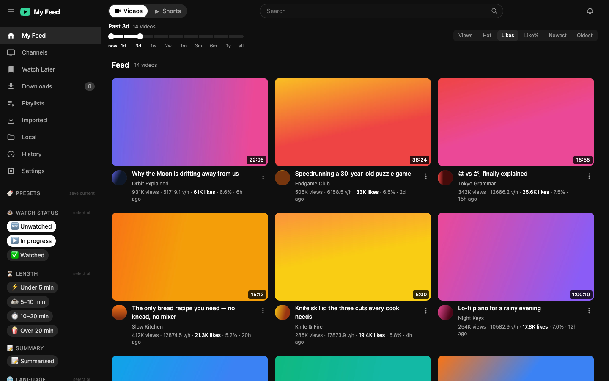
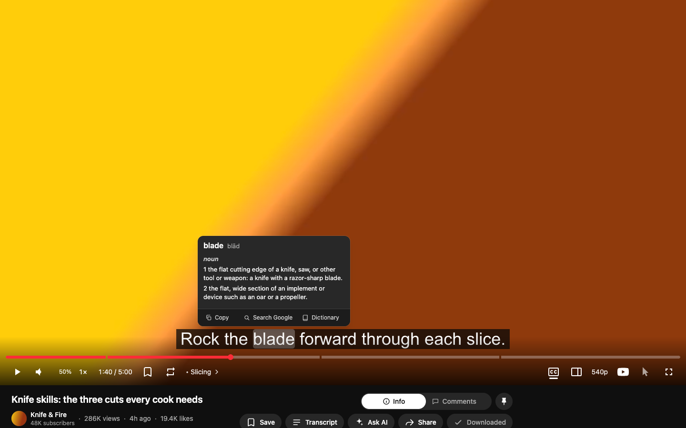
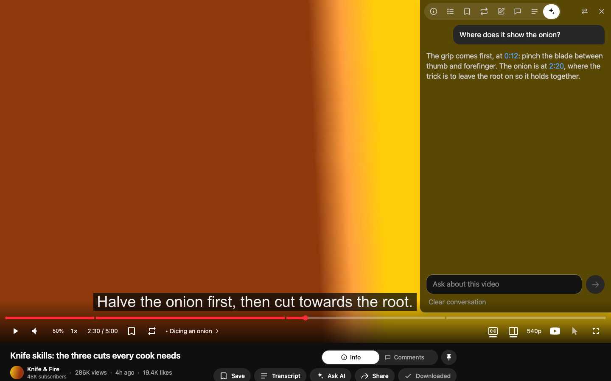
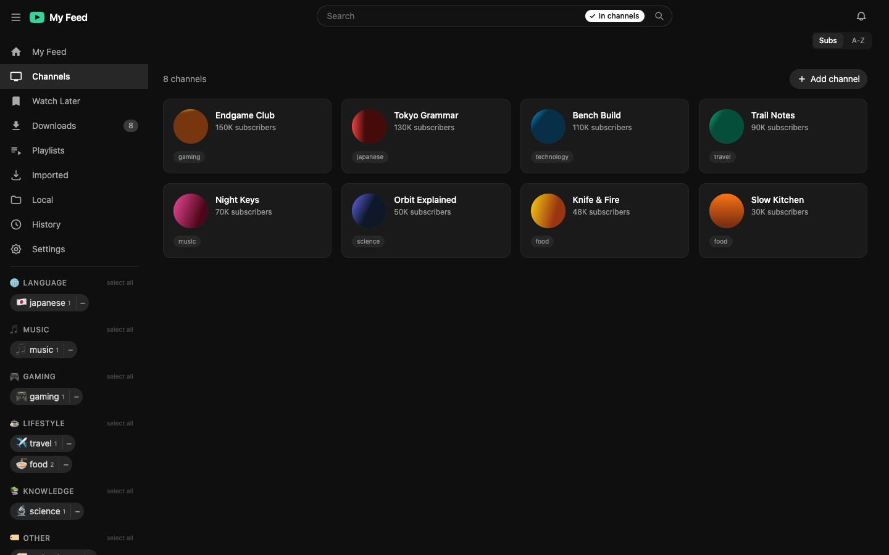
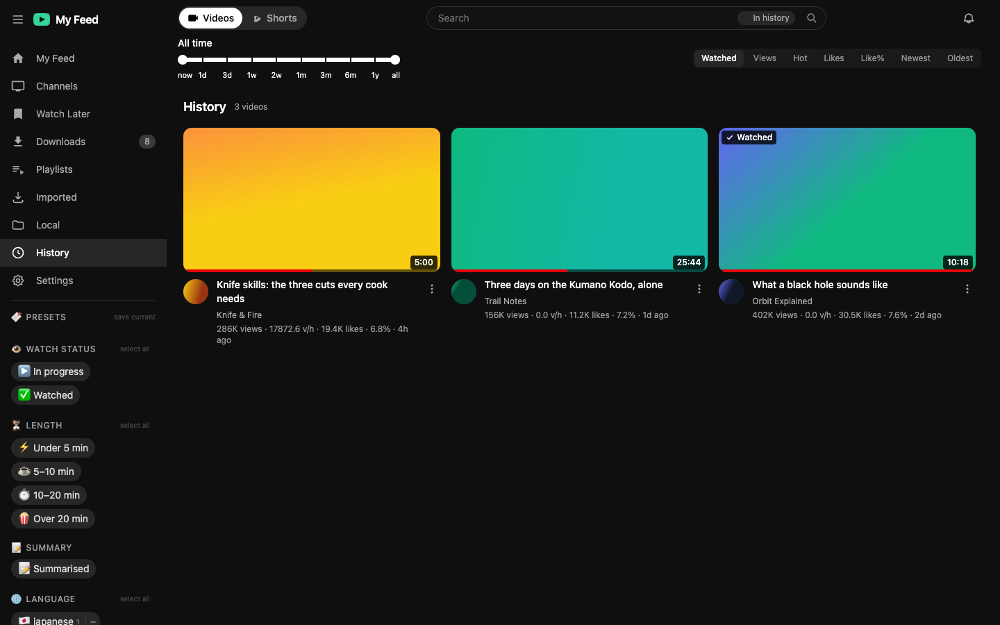
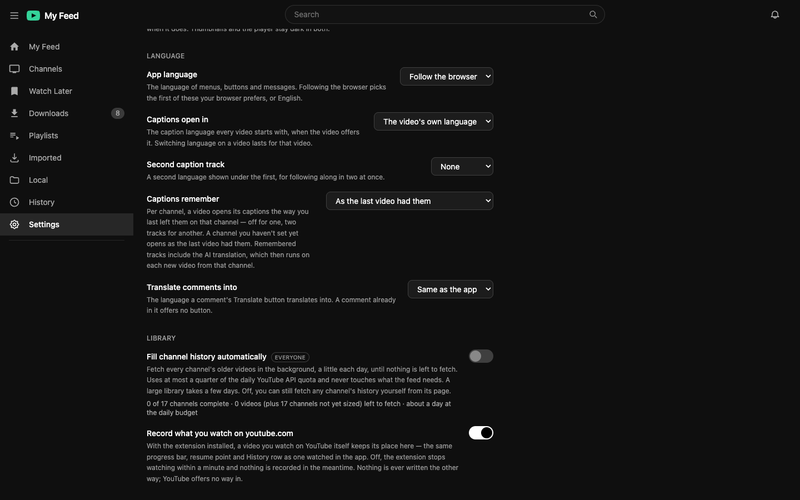
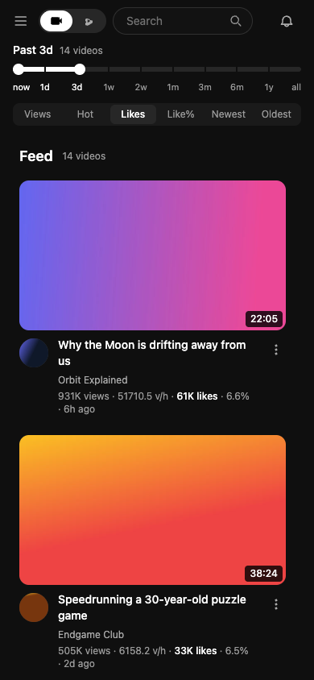

# YT Feed

A self-hosted YouTube app built around your subscriptions. It scans the
channels you follow, ranks their videos by how they're doing rather than by an
algorithm's guess at what you'll click, and plays them in a player of its own:
captions you can read into, a panel that knows the video, marks, notes, and an
up-next that walks a channel forward in time. Your whole household can use it,
each person with their own history and library.



<sub>Screenshots are of the end-to-end test app over made-up channels, not a real feed.</sub>

## A tour

### 1. The feed

Home is your channels' recent uploads, ranked. **Sort** by views, a views-per-hour
"Hot" score, likes, like rate, or date, and drag the **time window** to any span:
the past 3 days, or 3 days to 2 weeks ago. The **sidebar** narrows it down:

- **Watch status** — unwatched, in progress, watched. Home hides the watched by
  default, so it's about what you haven't seen
- **Length**, and **Summarised** for the videos you've had a summary written for
- **Topic and language tags**, assigned to each channel by an LLM. Each chip is
  split: its body shows only that tag, its `−` hides it
- **Presets** — name the selection you've built and put it back with one click

Shorts have a feed of their own; live streams and their recordings come in
with the rest. Hover a card and the real video plays inline,
muted, with captions and scrubbing. Search is typo-tolerant and can stay inside
one channel or one list. Cards carry a red resume bar, a Watched badge, the
playlists they're in, and your labels for them.

### 2. Watching



A card opens the video in the app at `/watch/:id`; Back returns you to exactly
where you were. With the companion extension installed, YouTube's own chrome is
stripped and the app draws its own control bar:

- **Chapters** cut the progress bar, and a chapter button names the one playing
- **Bookmarks** (`b`) and **repeat passages** (`[`, `]`) sit on the bar, each with
  a picture of its moment and an optional note. A video keeps as many passages
  as you mark
- **Speed** at the steps you choose, a **volume boost** to 6× for the one video
  that was mixed too quietly, **focus mode** for watching by keyboard, and a
  **next** button
- Every **keyboard shortcut** is a key you can rebind
- **Live streams** get a LIVE pill: red at the edge, grey once you've fallen
  behind. The track holds still while you watch behind the edge, and speeding
  up catches you up
- **Up next** is the same channel's next video *forward in time*, inside whatever
  filters brought you here, so you can work through a channel's backlog

**Captions** are rendered by the app, from the transcript:

- English, Chinese, Japanese, Korean, Thai and Vietnamese, as offered
- Two tracks at once, each above or below the picture
- An AI translation into Traditional Chinese
- Transcribed on your Mac with Whisper when YouTube has no captions at all
- Remembered per channel if you like: off for one, two tracks for another
- **Paused, rest the pointer on a word** to see its entries in the Mac's own
  dictionaries, with copy, a Google search, and Dictionary.app to hand

### 3. The panel on the video



`g` opens a panel down either side of the picture. It has one tab each for:

- **Info**
- **Chapters**
- **Bookmarks**
- **Repeat**
- **Notes**: labels, multi-value fields and a free-text note, suggested from what
  you've used before
- **Comments**, with a Translate button on comments in another language
- **Chat**, on a finished live stream: its chat replay, playing along with the
  video, with or without who wrote each line. Float it over the picture
  instead, with no times and a light backdrop or none, and drag it wherever
  the picture can spare it
- **Transcript**, where a click seeks
- **Ask AI**: a conversation answered from this video's own transcript, whose
  timestamps are buttons that seek

From any card's `…` menu you can also ask for a short or long **summary** and walk
away. The bell tells you when it's ready.

### 4. Channels



Channels come from your YouTube subscriptions, re-synced daily, or are added by
hand from a link, an `@handle`, or the extension's button on a channel page. An
LLM files each one under a topic and a language, and you can edit its labels. On
a channel's page, the LLM also sorts its videos into topics of their own, so you
can filter the channel by topic. A channel's older videos can be fetched back to
its first upload.

### 5. Your library



Everything is kept on the server, so it follows you across devices. The library
pages share the feed's windows, sorts, filters and search:

- **History** resumes every video where you stopped, including videos you watch
  on youtube.com when the extension is installed
- **Watch Later**
- **Playlists**, including ones imported from YouTube, which a Re-sync button keeps
  up to date
- **Downloads** play from disk, with no ads and offline
- **Imported** holds one-off videos from channels you don't follow
- **Local folders** turn a directory of video files into a feed of their own

Removing something offers to take it back for ten seconds.

### 6. Settings



Settings are per person unless marked *Everyone*:

- A dark or light **theme**
- The app in **six languages**: English, 繁體中文, 日本語, 한국어, ไทย and Tiếng Việt
- The **caption languages** every video opens with, and how captions are
  remembered
- Playback speeds, keyboard shortcuts, and which panel tab opens first
- The **time window and sort** each page opens on
- The deployment's own **connections**: AI key, Google sign-in, YouTube cookies
  and proxy
- **People**: the invite links that let the rest of the household in

### 7. On a phone



The app is built for a desktop and a keyboard. On a small screen the promise is
that nothing is out of reach: the sidebar becomes a drawer, Back (or a swipe)
leaves a video, and controls that only appeared on hover stay put.

### The browser extension (optional)

On **youtube.com** it puts *open in YT Feed*, *Watch Later* and *save to playlist*
buttons on every thumbnail. It also adds a channel from its page, and records
what you watch there into your History. On the **embedded player** it strips
YouTube's overlays, so the app can draw its own bar, and it boosts a quiet video
from inside the player's frame. Everything works without it; the app then keeps
YouTube's controls and lays its marks over them. Setup is
[below](#browser-extension-optional).

## Stack

| Layer | Tech |
|-------|------|
| Frontend | React 19 + TypeScript + Tailwind v4 + Vite |
| Backend | FastAPI (async) + yt-dlp + SQLAlchemy |
| Storage | SQLite (WAL) for all data; localStorage for per-browser conveniences (volume, caption picks) |
| Search | Meilisearch (optional companion service) |
| AI | OpenRouter for tagging, translation, summaries and Ask; mlx-whisper for local transcription |
| Extension | Chrome MV3 (optional) |

## Architecture

```
 yt-dlp ──► backend scan ──► SQLite ──► rank ──► FastAPI /api ──► React SPA
           (scheduler,                                              │
            every 15 min)                    hover / watch ─────────┘──► YouTube IFrame
```

A scheduler in the backend re-scans channels every 15 min into SQLite; the
frontend reads `/api/*`. The interesting logic is the **ranking** — a
views-per-hour "hot" score with an early-velocity burn-in, time windows named by
both their edges, and Bayesian shrinkage on the like-rate sort. See
[backend/README.md](backend/README.md#ranking--feed-shaping-rankingpy).

Component-level detail lives in the per-package READMEs:

- **[backend/README.md](backend/README.md)** — the API, the scan job, the data
  model, and the concurrency decisions (thread + `NullPool` + WAL, bounded
  preview pool).
- **[frontend/README.md](frontend/README.md)** — the SPA, History-API routing,
  and the hover-preview / mute logic.
- **[extension/README.md](extension/README.md)** — the optional companion
  extension: the *open in YT Feed* button on YouTube's video cards, what it
  hides on embedded players, and the one selector that rests on.

Investigations that shaped a decision, kept so it isn't relitigated:

- **[docs/youtube-history-writeback.md](docs/youtube-history-writeback.md)** —
  why watch history travels YouTube → app and never back, with the four routes
  that were measured and what each one hit.

## Deploy it yourself

```bash
git clone https://github.com/yun-cheng/yt-feed.git && cd yt-feed
docker compose up -d
docker compose logs app | grep setup
```

That last line prints a link with a one-time token in it. Open it, claim the
deployment, and you are its owner — after which nobody else can sign in unless
you invite them from **Settings → People**.

Then fill in what you want under **Settings → Connections**. Nothing there is
required to get a feed:

| | what it turns on | without it |
|---|---|---|
| **OpenRouter key** | channel/video tagging, caption translation, summaries, Ask | channels are tagged by language alone |
| **Google OAuth client** | sign in with Google, import your subscriptions | add channels by hand |
| **YouTube cookies / proxy** | getting past the bot check on a hosted address | see below |
| **Meilisearch key** | only for an external Meilisearch | the bundled one needs no key |

The keys live in the database, not in a file, so there is nothing to create
before the app will start. The matching `.env` variables still work as
bootstrap defaults if you prefer files — see [`.env.example`](.env.example).

One volume holds everything the app writes: the database, downloads,
thumbnails, the OAuth token and the generated session key. Backing that up is
the whole backup story.

**On a public address, set `PUBLIC_URL`.** It marks the session cookie `Secure`
(on plain http a `Secure` cookie is never stored, so sign-in appears to do
nothing) and it is where Google returns you after signing in. On a LAN, where
the network is already the perimeter, `OPEN_SIGNUP=true` lets anyone who can
reach the server have an account — which is how this app behaved before it could
be deployed anywhere else.

**A hosted address may get refused by YouTube.** Datacenter IP ranges are asked
to "confirm you're not a bot" far more often than home connections, and yt-dlp
is what the scan, the previews, the captions and the downloads all go through.
Settings → Connections takes a cookie jar or a proxy to answer that, and the
line under the cookies field says whether extraction is currently getting
through. A machine at home remains the reliable host. Full detail, including the
account-safety caveat on cookies, is in **[docs/deploying.md](docs/deploying.md)**.

Speech-to-text is absent from the image on purpose: `mlx-whisper` is
Apple-Silicon only, so the feature offers itself only where it can run.

## Setup (from source)

Run three processes. The frontend dev server proxies `/api` → `localhost:8000`.

### Backend

```bash
cd backend
python3 -m venv .venv && source .venv/bin/activate
pip install -r requirements.txt
uvicorn app.main:app --reload --timeout-graceful-shutdown 5 --port 8000
```

`--timeout-graceful-shutdown 5` keeps a code reload from hanging: without it,
the old server waits forever for the page's long-lived connection to close,
and the app sits loading.

### Frontend

```bash
cd frontend
npm install
npm run dev
```

### Search (optional)

```bash
meilisearch --db-path data/meili --http-addr 127.0.0.1:7700 --no-analytics
```

If Meilisearch isn't running, search returns nothing and everything else works.
All three are also defined in [`.claude/launch.json`](.claude/launch.json).

### Browser extension (optional)

What it does is in [the tour](#the-browser-extension-optional). Load
`extension/` unpacked from `chrome://extensions` (Developer mode → Load
unpacked), open its **Extension options** and paste the API key from the app's
**Settings → Extension**, then reload the app. The key says whose history and
Watch Later the buttons reach; on a machine with one account you can leave it
empty.

Everything works without it; the app keeps YouTube's own controls and lays the
bookmark / A–B marks over them instead. A video opened with the button need not
be from a channel you follow — the watch page resolves and caches whatever it's
never seen. See [`extension/README.md`](extension/README.md).

### Sharing it with the household

The dev server already listens on every interface, so anyone on your network can
open `http://<your-machine>:5173`. Add them under **Settings → People** and send
them the link it gives you — opening it signs them in and keeps them signed in.
Everyone keeps their own history, playlists, tags and saved videos; the channels,
videos and downloads are shared, so a channel two people follow is fetched once.

**The links are how people get in, and by default the only way.** Signing in
with Google admits nobody who wasn't invited — which starts mattering the moment
this app is reachable at an address you didn't choose. `OPEN_SIGNUP=true` restores
the older behaviour, where anyone who could reach the server could have an
account: the right setting for a LAN, where the network is already the perimeter,
and the wrong one for a public URL. `ALLOWED_EMAILS` names people explicitly
instead.

Google sign-in also only works where Google will send the browser back: it
accepts an `http` callback on `localhost` and nowhere else, so on a LAN it is for
whoever runs the server and the links are for everyone else. A deployment behind
https has no such limit.

The YouTube connection itself stays yours. It's a single token this app holds,
and the scan, the archive fill and the subscription resync all run on it — so
those are the owner's, and a family member signing in with Google can't repoint
them. What everyone else gets is the shared library plus their own everything
on top of it; they add channels by hand rather than importing subscriptions.


### AI tagging (optional)

LLM channel tagging needs an [OpenRouter](https://openrouter.ai) key. Paste it
into **Settings → Connections** — there is a **Test** button next to it — or set
`OPENROUTER_API_KEY` in `backend/.env` if you'd rather keep it in a file. A
stored key wins over the file; see
[`backend/app/runtime_config.py`](backend/app/runtime_config.py).

Without it, channels are tagged by language only. See
[`backend/README.md`](backend/README.md#channel-tagging-routerstagspy-llmpy).

## Channels

Who follows which channel lives in the database, per person. Import your
subscriptions by signing in with Google (`/api/auth/login`); `config/subscriptions.yaml`
is only a written-out mirror of the list now, not where it's read from. The
backend scheduler picks up new channels on its next scan; you can also force one
with `POST /api/refresh`.

The 15-minute scan only walks channels already in the DB. Reconciling against your
live YouTube subscriptions is a separate job that runs **once a day**: it
**deletes channels you've unsubscribed from** (and their videos) and adds new ones.
`POST /api/subscriptions/resync` forces one by hand; add `?dry_run=true` to preview
the prune first.

**You can also add a channel you're not subscribed to** — from the *Add channel*
button on the Channels page, from the pill the browser extension puts on a
YouTube channel page, or from the channel page of a video's uploader when the app
doesn't hold them yet. Paste a link, an `@handle` or a bare id. Such a channel is
marked `manual`, which is what keeps the daily resync from deleting it again; in
every other respect it's an ordinary channel, so it's scanned, tagged, ranked and
eventually archived like the rest. `DELETE /api/channels/{id}` (or the remove
button on its card) takes it back out.

## Tests

```bash
cd frontend && npm test
```

```bash
cd backend && pip install -r requirements-dev.txt && pytest
```

The backend suite runs against a temp SQLite file, never your real feed, and
makes no network calls. See each side's README for what's covered.

The frontend also has an end-to-end suite, in a real browser:

```bash
cd frontend && npm run test:e2e
```

It drives your installed Google Chrome, headless, against a backend of its own
on port 8765 over a scratch feed of generated videos, with a Meilisearch of its
own on 7709 when the binary is installed — never your feed, your search index,
or YouTube. Among its specs are screenshot tests of single features (the
progress bar's marks, the menus, the captions), whose baselines belong to the
machine that made them; see the frontend README.

And one more, for the seam neither suite can reach — an image, a volume, and
a process that has never run before:

```bash
scripts/smoke-deploy.sh
```

It builds the image, brings it up against an empty volume on its own project
name and port, and checks that a fresh deployment serves the app, reports itself
unclaimed, refuses to be configured by a stranger, and hands its owner a key that
cannot be read back out. It removes its own containers and volumes on the way
out, and never touches your `data/` or a running dev server.
